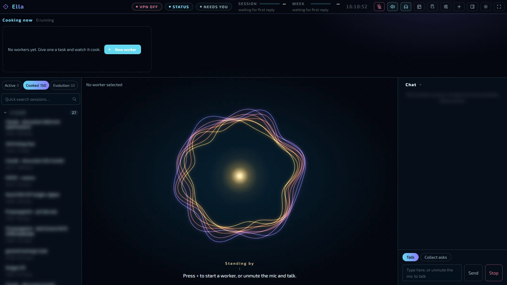
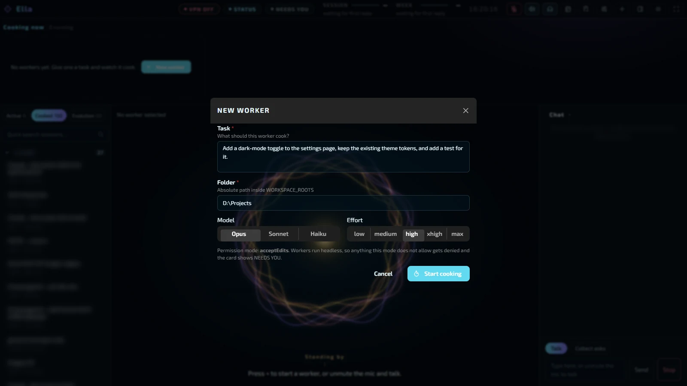
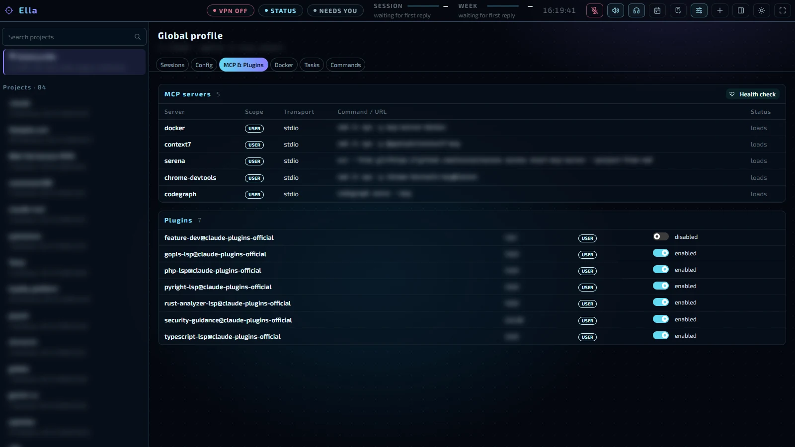
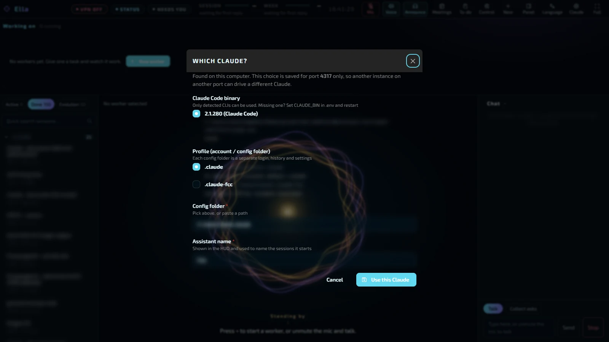
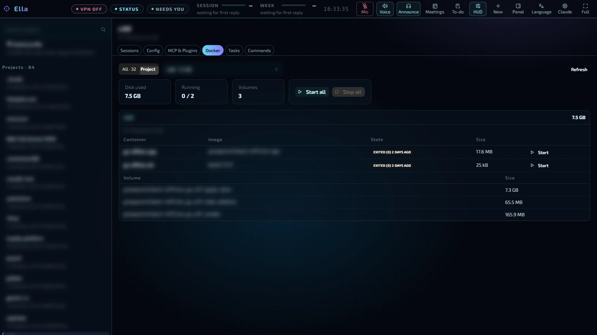
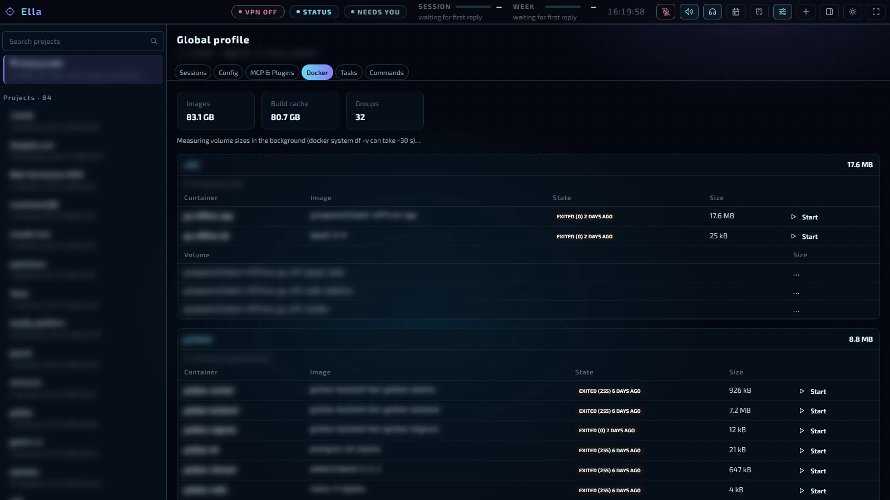

# Ella HUD

A sci‑fi command center for **Claude Code**. It runs several Claude Code sessions ("workers") side by side, streams what each one is doing live, and lets you talk to them out loud.

> Unofficial community project. Not affiliated with or endorsed by Anthropic.



<sub>Private session titles and paths are blurred in these screenshots.</sub>

- **Working on**: one live card per worker, showing the tool it is running ("Bash: typecheck web"), its model and effort, and any subagents it spawned.
- **Voice**: speak to the selected worker. When a worker finishes its turn, Ella reads the reply aloud, and the orb reacts to your mic and her voice.
- **Done**: your recent Claude Code sessions are **auto‑detected**, with no setup, and grouped by project. Click one to continue it as a worker. The session is forked, so the original is never touched.
- **Evolution**: the memory notes Claude Code has written recently.
- **SESSION / WEEK meters**: your plan usage and reset times, taken from the CLI's own rate‑limit events.
- **NEEDS YOU**: flags workers that hit a permission wall or an error.
- **To‑do**: a small local list, saved in `data/todos.json`.

## Screenshots

**Start a worker.** Give it a task and a folder, then pick the model and effort:



**Control Center → Config.** Your global profile and each project's `CLAUDE.md`, skills, rules, agents, slash commands, permissions and hooks, all read‑only:


**Control Center → MCP & Plugins.** Every MCP server with its scope, a one‑click health check, and plugin switches:



**Which Claude?** Ella finds every Claude Code install and profile on the machine. Pick one and name your assistant:



**Control Center → Docker → Project.** Pick a project to see its disk use, its containers and volumes, and Start all / Stop all:



**Control Center → Docker → All.** Disk used by images and build cache, and every project's containers and volumes:



## Which Claude plan do I need?

Ella drives the **Claude Code CLI**, so you need a plan that includes Claude Code:

| Plan | Works? |
|---|---|
| Claude **Pro**, **Max**, **Team**, **Enterprise** (logged in with `/login`) | ✅ Yes, and the usage meters show your limits |
| Anthropic Console **API key** | ✅ Yes, but you pay per token and there are no plan meters |
| Claude **Free** / claude.ai chat only | ❌ No. The free plan doesn't include Claude Code |

Every worker draws on the same usage limit as your normal Claude Code sessions. Running 3–4 at once uses it up faster.

## Requirements

- **Claude Code CLI**, installed and logged in
- **Node.js 24+** (the server runs TypeScript natively, so there is no build step for it)
- **pnpm** (comes with Node through Corepack) or npm
- **Chrome or Edge** for voice input. Safari has partial support, and Firefox has no speech recognition, so typing still works there.

### 1. Install Claude Code and log in (once)

**macOS / Linux**
```bash
curl -fsSL https://claude.ai/install.sh | bash
claude
```

**Windows (PowerShell)**
```powershell
irm https://claude.ai/install.ps1 | iex
claude
```

Inside `claude`, type `/login`, finish the login in your browser, then exit with `/exit`.

You can also install it with `npm install -g @anthropic-ai/claude-code`.

### 2. Install Node 24 (if `node -v` shows an older version)

| OS | Command |
|---|---|
| Windows | `winget install OpenJS.NodeJS.LTS` |
| macOS | `brew install node@24` |
| Linux | `curl -fsSL https://raw.githubusercontent.com/nvm-sh/nvm/v0.40.3/install.sh \| bash` then `nvm install 24` |

## Setup: clone and run

**Windows (CMD)**
```bat
git clone https://github.com/chetansaini53/ella-hud.git
cd ella-hud
corepack enable
pnpm install
copy .env.example .env
pnpm start
```

**macOS / Linux**
```bash
git clone https://github.com/chetansaini53/ella-hud.git
cd ella-hud
corepack enable
pnpm install
cp .env.example .env
pnpm start
```

Then open **http://127.0.0.1:4317** in Chrome or Edge.

> Prefer npm? Use `npm install` and `npm start`.
>
> On Windows, if `corepack enable` says access is denied, run it once from an Administrator terminal, or run `npm install -g pnpm`.

### Point it at your projects

Workers may only run inside the folders listed in `WORKSPACE_ROOTS`, which defaults to your home folder. Edit `.env`:

```ini
# Windows (separate with ;)
WORKSPACE_ROOTS=D:\Projects;C:\Users\you\code
# macOS / Linux (separate with :)
WORKSPACE_ROOTS=/Users/you/code
```

Restart `pnpm start` after you change `.env`.

## What is auto‑detected

| Thing | How |
|---|---|
| Your Claude Code sessions | Read from `~/.claude/projects` (or `$CLAUDE_CONFIG_DIR/projects`). Titles, project, time and number of asks |
| The `claude` binary | `claude` on PATH on macOS/Linux. On Windows, the native install (`%USERPROFILE%\.local\bin\claude.exe`) or the npm global install |
| Your settings and hooks | Workers are ordinary Claude Code sessions, so your `CLAUDE.md`, permissions, hooks and MCP servers all apply |
| Plan usage | From the CLI's `rate_limit_event` stream, shown after a worker's first reply |
| VPN | A tunnel adapter such as WireGuard, Tailscale or OpenVPN with a live address |

## More than one Claude? (two accounts or two installs)

Ella **auto‑detects** every Claude Code setup on the machine:

- **Binaries:** each `claude` CLI on your PATH, plus the native and npm installs. A file only counts if `--version` reports Claude Code. Desktop‑app helpers such as `claude-desktop` are never run.
- **Profiles:** every config folder, meaning `~/.claude` plus any `~/.claude-*` folder that holds a Claude login or history. Wrapper scripts that set `CLAUDE_CONFIG_DIR` (for example a `claude2` script) are read, not run, and their folder is added too.

On first start, if it finds more than one, Ella asks **which Claude** to use and **what to call the assistant** (Ella, Claudia, anything). Only binaries Ella detected can be picked. If yours is somewhere unusual, set `CLAUDE_BIN` in `.env` and restart. You can change this later with the **Claude** button in the header.

The choice is saved **per port** (`data/instance-<port>.json`). To drive two Claudes side by side, run a second instance on another port:

```bash
pnpm start                 # first instance on 4317 (also builds the UI)
PORT=4318 pnpm serve       # macOS / Linux: second instance on 4318
```

```bat
set PORT=4318&& pnpm serve
```

The second command is for Windows CMD. In PowerShell, use `$env:PORT=4318; pnpm serve`.

Open http://127.0.0.1:4318 and pick the other Claude there. Each instance keeps its own workers, its own Claude profile and its own name.

## Using it

| Control | What it does |
|---|---|
| **+** (header) | Start a new worker: task, folder, model (Opus/Sonnet/Haiku), effort |
| 📅 / ✅ (header) | Open **Meetings** and **To-do** in a modal. The to-do icon shows how many are still open |
| Quick search (left) | Type a few words. The dropdown ranks the best matches across live workers and recent sessions; pick one to open it |
| Left sidebar | Sessions are grouped by project, with the newest project first. Click a group name to collapse or expand it |
| Card in *Working on* | Select that worker. The chat and the voice target follow it |
| Item in *Done* | Continue that old session as a new forked worker |
| **Mic** | Start or stop listening. Speech goes to the selected worker |
| **Voice** | Turn the assistant's spoken replies on or off |
| **Announce** | Announce every worker that finishes, not only the one you're talking to |
| **Language** | Voice language (English India/US/UK, Hindi) |
| **Claude** | Switch which Claude binary or profile this instance drives, and the assistant's name |
| **Talk / Collect asks** | *Talk* sends each spoken sentence right away. *Collect asks* gathers them in the box until you press Send |
| **Stop** | Kill the selected worker's current turn. You can message it again later and it resumes |

A worker's process exits after every turn and is resumed (`--resume`) on your next message, so idle workers cost no RAM.

## Control Center

The sliders icon in the header switches the HUD to the **Control Center**. On the left is **Global profile**, followed by every project Claude Code knows: the folders in `~/.claude.json` plus any folder that has session transcripts. Each one has these tabs:

| Tab | Global profile | A project |
|---|---|---|
| **Sessions** | Every Claude Code session running right now (`claude agents --json`) | Its running sessions, plus all of its session files. Click **Open** to continue one as a worker |
| **Config** | `~/.claude/CLAUDE.md`, rules, skills, agents, slash commands, permissions, hooks | That project's `CLAUDE.md`, `.claude/` settings, skills, rules, agents, hooks, permissions |
| **MCP & Plugins** | User MCP servers, a **health check** (`claude mcp list`), and installed plugins with enable/disable | User, local and project servers. Project `.mcp.json` servers can be approved or rejected |
| **Docker** | Two views. **All** shows disk used by images and build cache, plus every compose project grouped by Claude project. **Project** lets you pick a project from a dropdown and see its disk use, running count, containers and volumes, with Start all / Stop all | Opens on **Project**, with this project already picked |
| **Tasks** | Tasks started from Ella, plus Playwright and browser-automation processes | Its `package.json` scripts and Playwright (run tests, UI mode, report) with one‑click start/stop and live logs. Also lists other processes using the folder |
| **Commands** | Read‑only `claude` commands: `--version`, `doctor`, `auth status`, `mcp list`, `plugin list`, `agents` | The same commands, run inside the project folder |

**Ella does not change your Claude Code setup on its own.** Everything is read‑only until you click one of these four actions, and each one asks you to confirm first:

- Approving or rejecting a project `.mcp.json` server writes `.claude/settings.local.json` (a backup is kept as `settings.local.json.ella-bak`). This is the same file Claude Code's own approval prompt writes.
- Enabling or disabling a plugin runs the official `claude plugin enable|disable` command.
- Starting or stopping a Docker container.
- Killing a listed process.

Secrets are masked in every view: MCP `env` and `headers`, token‑looking arguments, and keys whose names contain `key`, `token` or `secret`.

## Configuration (`.env`)

All values are optional.

| Variable | Default | Meaning |
|---|---|---|
| `PORT` | `4317` | UI and API port (bound to 127.0.0.1 only) |
| `WORKSPACE_ROOTS` | home folder | Folders workers may run in |
| `DEFAULT_CWD` | first root | Folder pre‑filled in the New worker form |
| `WORKER_PERMISSION_MODE` | `acceptEdits` | `default` · `acceptEdits` · `plan` · `bypassPermissions` |
| `MAX_WORKERS` | `4` | Workers running at the same time (1–8) |
| `CLAUDE_BIN` | auto | Full path to `claude` if it isn't detected |
| `CLAUDE_CONFIG_DIR` | `~/.claude` | Only if you moved your Claude Code config |

**About permissions:** workers run headless, so they can't stop and ask you. Anything your permission mode and Claude Code settings don't allow is denied, and the card shows **NEEDS YOU**. Allow the tools you trust in your Claude Code settings, or change `WORKER_PERMISSION_MODE`. `bypassPermissions` lets workers do anything, so use it only in folders you can afford to lose.

## Security

Ella can start Claude Code with your account, so the server is locked down:

- It listens on **127.0.0.1 only**, so nothing on your network can reach it.
- **Host allowlist**: blocks DNS‑rebinding attacks from websites.
- **Origin check, plus same‑origin proof on every state‑changing request**: other websites open in your browser can't start or steer workers.
- A worker's folder must resolve (symlinks included) to a path inside `WORKSPACE_ROOTS`.
- `claude` is spawned without a shell, and your text goes over stdin, never into command‑line arguments.
- Voice is off until you press the mic. Anything it hears while on is sent as a prompt, so mute it around other audio.

Found a security issue? Please open a private security advisory on GitHub instead of a public issue.

## How it works

```
Browser (React + Mantine)  ◀─ SSE ─  Node server (zero runtime deps)  ─ stdin/stdout ─▶  claude -p --input-format stream-json
        │ fetch (JSON)                 │                                                --output-format stream-json
        └─────────────────────────────▶│ reads ~/.claude/projects/*.jsonl (incremental)
```

Each worker is `claude -p` in stream‑JSON mode. The server parses the event stream (init, assistant text, tool calls, subagent tasks, results and rate‑limit events) and pushes small deltas to the browser over Server‑Sent Events.

## Troubleshooting

| Symptom | Fix |
|---|---|
| Worker says *"Failed to authenticate"* | Run `claude`, type `/login`, then send the message again |
| Wrong Claude account or install | Click **Claude** in the header and pick the right binary and profile. The choice is saved for that port only |
| *"Could not start claude"* | Set `CLAUDE_BIN` in `.env` to the full path of `claude` (`where claude` on Windows, `which claude` on macOS/Linux) |
| *"cwd is outside WORKSPACE_ROOTS"* | Add that folder's parent to `WORKSPACE_ROOTS` |
| SESSION / WEEK show "—" | They fill in after a worker's first reply. API‑key users don't get plan meters |
| Mic does nothing | Use Chrome or Edge, and allow the microphone for 127.0.0.1 |
| *"Port 4317 is busy"* | Set another `PORT` in `.env` |
| Done list is empty | You have no Claude Code sessions yet, or set `CLAUDE_CONFIG_DIR` if your config lives elsewhere |

## Development

```bash
pnpm dev:server   # API with auto-reload (also trusts the Vite dev port)
pnpm dev:web      # UI with hot reload → http://127.0.0.1:5173
pnpm test         # server tests (node:test)
pnpm typecheck
```

Stack: Node 24 (native TypeScript), React 19, Mantine 9, Tabler icons, Vite 8.

## License

[MIT](LICENSE)
